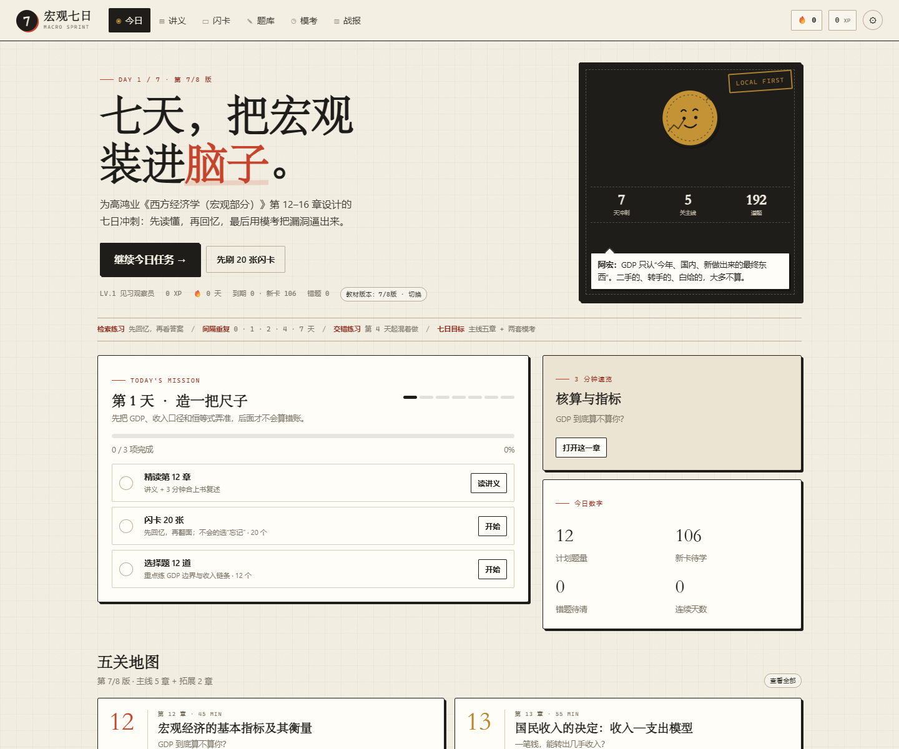
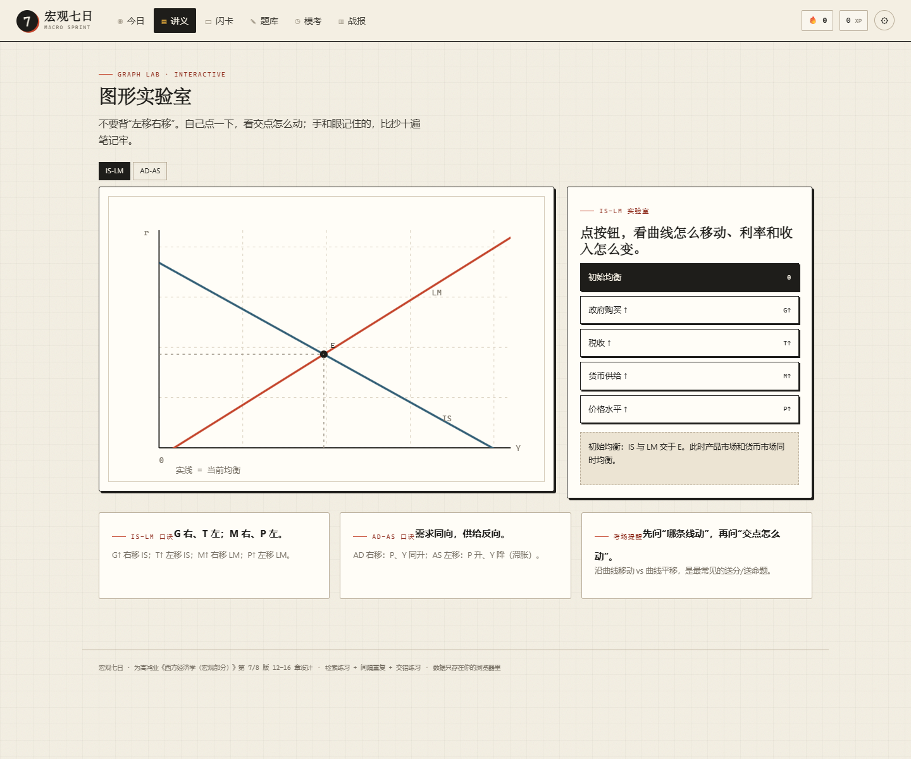
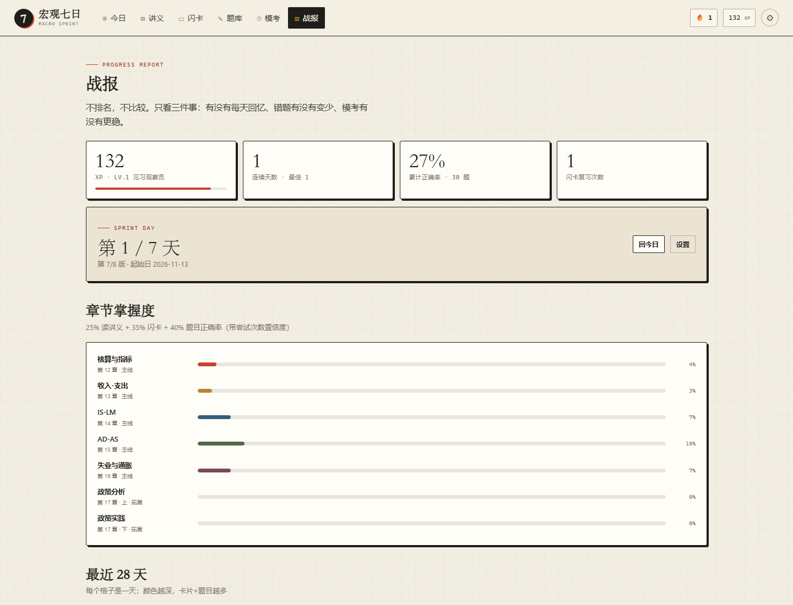

# 宏观七日 · Macro Sprint

为高鸿业《西方经济学（宏观部分）》**第 12–16 章**设计的一周冲刺学习平台。  
不是视频课，也不是笔记搬运：它把「检索练习 + 间隔重复 + 交错练习 + 即时反馈」做成一个打开就能用的本地 Web App。

> 默认按 **第 7/8 版** 编排：12 核算 → 13 收入-支出 → 14 IS-LM → 15 AD-AS → 16 失业与通胀。  
> 在右上角「设置」里可以切换到 **第 5/6 版**：12 核算 → 13 简单模型 → 14 IS-LM → 15 政策分析 → 16 政策实践。

## 预览







---

## 快速开始

### 方式一：双击启动（Windows，需 Python）

双击 `启动.bat`。它会启动本地服务器并打开浏览器。

### 方式二：命令行

```bash
cd macro-sprint
python serve.py
# 打开 http://127.0.0.1:8765/index.html#/today
```

### 方式三：直接打开

直接双击 `index.html` 也能用。  
但不同浏览器对 `file://` 下的 localStorage 处理略有差异，**推荐用本地服务器**，学习记录更稳定。

---

## 它包含什么

| 内容 | 数量 |
|---|---|
| 知识模块 | 7 个（5 个主线 + 2 个拓展） |
| 讲义 | 7 章，每章含核心逻辑、公式、说人话解释、考场陷阱 |
| 闪卡 | 106 张 |
| 题库 | 192 道（单选 126 / 判断 28 / 计算 27 / 简答 11） |
| 模考 | 20 题 / 25 分钟 / 自动评分与分章报告 |
| 图形工具 | IS-LM 与 AD-AS 两个可交互实验室 |
| 学习记录 | 本地 localStorage，支持 JSON 导出/导入 |

### 版本映射

| 模块 | 第 7/8 版 | 第 5/6 版 |
|---|---|---|
| 核算与指标 | 第 12 章 | 第 12 章 |
| 收入-支出 | 第 13 章 | 第 13 章 |
| IS-LM | 第 14 章 | 第 14 章 |
| AD-AS | 第 15 章 | 第 17 章（拓展） |
| 失业与通胀 | 第 16 章 | 第 18 章（拓展） |
| 政策分析 | 第 17 章·上（拓展） | 第 15 章 |
| 政策实践 | 第 17 章·下（拓展） | 第 16 章 |

两套主线共用同一套知识模块，切换版本只改变「主线/拓展」的归属和章号，不会丢失进度。

---

## 七日路线

| 天 | 主题 | 核心动作 | 为什么这样排 |
|---|---|---|---|
| Day 1 | 造一把尺子 | 第 12 章 + 20 张卡 + 12 题 | 先把 GDP 边界、收入口径、恒等式弄准，后面所有计算都靠它 |
| Day 2 | 让乘数转起来 | 第 13 章 + 20 张卡 + 12 题 + 回炉第 12 章 | 乘数是计算题主战场；隔天回炉第一次间隔 |
| Day 3 | 画出 IS-LM | 第 14 章 + 图形实验室 + 20 张卡 + 14 题 | 曲线必须自己推一遍，不能背图 |
| Day 4 | 把价格请进来 | AD-AS + 20 张卡 + 14 道混合题 | 开始交错练习，逼自己判断“这题考哪章” |
| Day 5 | 失业与通胀 | 第 16 章 + 20 张卡 + 14 题 + 错题回炉 | 短期/长期菲利普斯曲线是高频易混点 |
| Day 6 | 整合与第一次模考 | 总图 + 30 张到期卡 + 20 题模考 | 不学新章，用模考找漏洞 |
| Day 7 | 考前日 | 错题本 + 公式墙 + 第二次模考 | 只收口，不开新坑 |

闪卡间隔为 **0 / 1 / 2 / 4 / 7 / 14 天**。一周冲刺主要用到前五个盒子；考后继续跑两周，能把短期记忆拉长。

---

## 核心功能

- **今日**：七日路线、今日任务、到期卡/新卡/错题、章节地图。
- **讲义**：每章「核心逻辑 → 公式 → 说人话 → 考场陷阱」，可标记已读。
- **闪卡**：先回忆再翻面，四档评分（忘记/模糊/记住/秒答），自动排下次出现时间。
- **题库**：按章练习、交错练习、错题回炉；答错自动进错题本，答对自动移出。
- **模考**：20 题 / 25 分钟，交卷后给分章报告、逐题解析和错题回顾。
- **图形实验室**：点 `G↑ / T↑ / M↑ / P↑` 或 `AD↑ / AS←`，看曲线和交点怎么动。
- **公式墙**：一键遮住全部公式，先默写再点开对答案。
- **战报**：章节掌握度、28 天热力图、模考轨迹、成就、错题本、研究依据。
- **数据**：JSON 导出/导入；所有记录只在本机，不上传、不排名。

---

## 为什么这样设计：研究依据

完整版见 [`docs/research.md`](docs/research.md)。这里只放结论与出处。

### 1. 检索练习：先回忆，再看答案

Roediger 与 Karpicke 的经典实验发现：读完材料后做一次回忆测试，比反复阅读在一周后记得更多，尽管学习者自己会预测“重读更有效”。Dunlosky 等对 10 种学习法的系统评估中，**practice testing** 与 **distributed practice** 获得最高效用评级；重读、划线、摘要的效用较低。

- [Roediger & Karpicke (2006), *Test-Enhanced Learning*, Psychological Science](https://doi.org/10.1111/j.1467-9280.2006.01693.x)
- [Dunlosky et al. (2013), *Improving Students' Learning With Effective Learning Techniques*](https://www.psychologicalscience.org/observer/which-study-strategies-make-the-grade-2)

**产品映射**：闪卡必须先翻面再评分；每题先选再看解析；简答题先写关键词再看参考答案。

### 2. 间隔重复：在快忘时复习

Cepeda 等的综述指出，两次学习之间的最佳间隔约为最终保留间隔的 **10–20%**。准备一周后的考试，间隔 1 天左右最合适。Rohrer 与 Pashler 也发现，过度学习在 4 周后优势消失，分散学习更有利于长期保留。

- [Cepeda et al. (2006), *Distributed Practice in Verbal Recall Tasks*, Psychological Bulletin](https://www.psychologicalscience.org/observer/temporal-spacing-and-learning)
- [APS (2007), *Cramming Doesn't Work in the Long Run*](https://www.psychologicalscience.org/news/releases/back-to-school-cramming-doesnt-work-in-the-long-run.html)

**产品映射**：0/1/2/4/7/14 天的 Leitner 盒子；每天先清到期卡，再补新卡；第 2、5 天安排“回炉”。

### 3. 交错练习：混着做，才像考试

Rohrer 与 Taylor 发现，把不同题型混排的练习，在一周后的测试中显著优于按题型集中练习。教科书“一节一练”反而鼓励了最无效的集中练习。

- [Rohrer & Taylor (2007), *The shuffling of mathematics problems improves learning*, Instructional Science](https://doi.org/10.1007/s11251-007-9019-4)

**产品映射**：第 4 天起混合出题；模考按章平均抽题；题库的“交错练习”不显示章节提示。

### 4. 游戏化：绑在“回忆”上，不绑在“登录”上

Sailer 与 Homner 的元分析发现，游戏化对认知学习有中小幅正向效应（g≈0.49），但对动机的效应更小、更不稳定。Deci 等对 128 个实验的元分析提醒：可预期、与任务绑定的物质奖励可能削弱内在动机。

- [Sailer & Homner (2020), *The Gamification of Learning: a Meta-analysis*](https://doi.org/10.1007/s10648-019-09498-w)
- [Deci, Koestner & Ryan (1999), *A Meta-Analytic Review of Experiments Examining the Effects of Extrinsic Rewards on Intrinsic Motivation*](https://doi.org/10.1037/0033-2909.125.6.627)

**产品映射**：XP 只奖励“复习卡片 / 答对题 / 读完讲义”，不奖励“打开 App”；连续天数只统计“有回忆行为”的天；没有排行榜、没有段位压迫、没有“连续 100 天”式的焦虑设计。

### 5. 一周突击的诚实边界

一周突击能显著提高**考试表现**，但很难形成长期保留。本平台的策略是：用最短时间建立“可提取的框架”，考后继续用闪卡盒子跑两周。  
如果你有更长时间，把同样的流程拉长到 3–4 周，效果会更好。

---

## 借鉴了哪些产品/开源项目

- **Anki / FSRS**：间隔重复的调度思路。本平台没有实现完整的 FSRS，而是用更透明、适合一周冲刺的 Leitner 盒子（0/1/2/4/7/14 天）。
  - [Open Spaced Repetition](https://github.com/open-spaced-repetition)
- **Vibe Learn**：local-first、静态课程、markdown 讲义 + 闪卡 + 间隔复习 + JSON 备份的产品结构。
  - [jmilne22/vibe-learn](https://github.com/jmilne22/vibe-learn)
- **Duolingo**：把连续天数与每日练习绑定。本平台保留“连续天数”，但只统计真实回忆行为，不做排行榜。
- **Khan Academy**：掌握度（mastery）而不是“看完即学会”。本平台用“读讲义 25% + 闪卡 35% + 题目正确率 40%”估算章节掌握度。
- **Quizlet Learn**：自适应出题。本平台的“错题回炉”和“交错练习”会优先抽低正确率题目。

---

## 目录结构

```
macro-sprint/
├─ index.html
├─ styles.css
├─ favicon.svg
├─ 启动.bat
├─ serve.py
├─ data/
│  ├─ core.js          # 元数据、版本映射
│  ├─ ch12.js ...      # 七个模块的讲义、公式、闪卡、题目
│  ├─ pol1.js / pol2.js
│  └─ plan.js          # 七日计划、成就、研究依据
├─ js/
│  ├─ core.js          # 状态、Leitner 调度、统计、导入导出
│  ├─ views.js         # 今日 / 讲义 / 公式 / 关于 / 设置
│  ├─ practice.js      # 闪卡 / 刷题 / 模考
│  ├─ stats.js         # 战报 / 图形实验室
│  └─ app.js           # 路由、事件、计时器、键盘
├─ tools/
│  ├─ validate.cjs     # 数据与题库静态校验
│  └─ smoke.cjs        # Playwright 浏览器冒烟测试
├─ docs/
│  └─ research.md      # 学习法研究笔记
└─ shots/              # 页面截图（可删）
```

---

## 如何加题 / 改内容

1. 打开 `data/chXX.js`，在对应模块的 `quiz` 数组里加一道题：

```js
{
  id: "q12-31",              // 全局唯一
  type: "single",           // single | tf | num | short
  diff: 2,                  // 1–3
  topic: "GDP边界",
  q: "题干……",
  options: ["A", "B", "C", "D"],
  answer: 1,                // 单选为下标；判断为 true/false；计算为数字
  explain: "解析……"
}
```

2. 闪卡加在 `cards` 数组：

```js
{ id: "c12-19", tag: "公式", front: "问题……", back: "答案……" }
```

3. 运行校验：

```bash
node tools/validate.cjs
```

会检查：ID 是否重复、单选答案下标、判断题布尔值、计算题数字、简答题关键词、每个版本机考题是否足够 20 道、七日计划是否完整。

---

## 测试

### 数据校验

```bash
node tools/validate.cjs
```

当前结果：7 个模块、106 张闪卡、192 道题；7/8 版与 5/6 版均可组出 20 题模考。

### 浏览器冒烟测试

需要本机有 Playwright（以及 Edge/Chrome）：

```bash
# 在临时目录安装 playwright 后，用 NODE_PATH 指向它
$env:NODE_PATH="C:\path\to\node_modules"
node tools/smoke.cjs
```

测试覆盖：今日渲染 → 刷题 10 题出成绩 → 闪卡翻面评分 → 模考 20 题交卷 → 战报 → 讲义标记已读 → 公式遮罩 → 图形实验室 → 版本切换 → 移动端无横向溢出 → localStorage 持久化。

---

## 已知限制

- 题目为**原创练习**，覆盖教材核心考点，但不等同于教材课后题或考研真题；老师指定的题型/口径优先。
- 奥肯定律系数、政策乘数等存在版本差异；解析中标注了“教材口径”，遇到老师不同说法以课堂为准。
- 学习记录只存在浏览器 localStorage；换浏览器、清缓存会丢失，建议定期在设置里导出 JSON。
- 七天路线是模板，不是强制日历；错过一天可以继续做，进度不会“惩罚”你。
- 图形实验室是**示意性**的曲线，用于理解方向和交点，不是精确的函数绘图。

---

## 声明

- 本平台不复制教材正文；讲义为围绕考点的原创总结，题目为原创练习。
- 高鸿业《西方经济学》版权归原作者及中国人民大学出版社所有。
- 代码可自由修改用于个人学习；如果用于公开教学，请注明来源并自行复核内容准确性。
